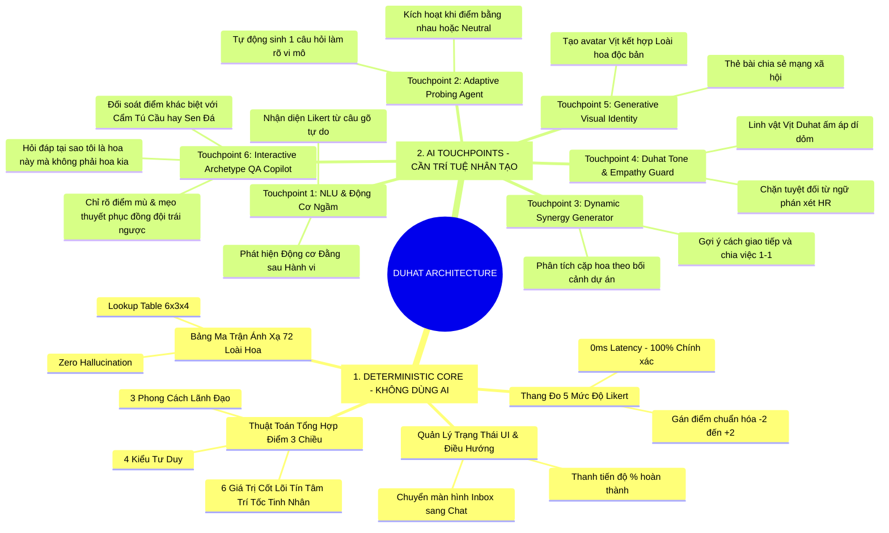

# 🧠 DUHAT AI - BẢN THẨM ĐỊNH KNOWLEDGE BASE & NĂNG LỰC AI
## Tính năng: Khám Phá Tính Cách AI (Format 5 Mức Độ Likert & 72 Loài Hoa)
**Tài liệu chuẩn bị bởi:** Product Marketing Team (PMM)  
**Kính gửi:** Lead Product Manager (PM), AI Engineering Team, Tech Leads  
**Mục tiêu văn bản:** Làm rõ hai câu hỏi cốt lõi:  
1. **Cần AI ở chỗ nào?** *(Phân định rõ ranh giới: AI-Powered vs Deterministic Rule-Based để tối ưu chi phí & độ chính xác)*  
2. **Khả năng đáp ứng của AI đến đâu?** *(Thẩm định tính khả thi kỹ thuật, SLA thời gian phản hồi, rủi ro ảo giác, chiến lược dự phòng Fallback & chi phí vận hành)*  

🌐 **Bản mẫu tương tác Trực Tuyến (Live Online Links):**
* **Link Trực Tiếp (Không chặn bởi tường lửa công ty):** [https://duhat-personality.surge.sh/](https://duhat-personality.surge.sh/)
* **Link Dự Phòng (GitHub Pages):** [https://daothang38.github.io/duhat-personality-test/](https://daothang38.github.io/duhat-personality-test/)
* **Bản Trình Diễn Báo Cáo Trực Quan (Interactive Executive Deck):** [https://duhat-personality.surge.sh/AI_KNOWLEDGE_BASE_PRESENTATION.html](https://duhat-personality.surge.sh/AI_KNOWLEDGE_BASE_PRESENTATION.html)

---

## 1. Bản Đồ Tri Thức AI (AI Knowledge Tree & System Topology)

Sơ đồ cây phân định toàn bộ kiến trúc tính năng thành 2 nhánh: **Nhánh Thuật Toán Cố Định (Deterministic Engine)** và **Nhánh Trí Tuệ Nhân Tạo (6 AI Touchpoints)**.



---

## 2. Bong Bóng Phân Cấp Năng Lực (Bubble Architecture: Feasibility vs Impact)

Biểu đồ bong bóng định vị 6 điểm chạm AI theo 2 trục: **Mức Độ Ảnh Hưởng Đến Trải Nghiệm (User Impact)** và **Độ Khó / Khả Năng Đáp Ứng Kỹ Thuật (Technical Feasibility)**.

```mermaid
quadrantChart
    title Ma Trận Thẩm Định Điểm Chạm AI (Impact vs Feasibility)
    x-axis Độ Khó Kỹ Thuật (Dễ/Khả Thi Cao --> Khó/Rủi Ro Cao)
    y-axis Giá Trị Trải Nghiệm Khách Hàng (Thấp --> Rất Cao)
    quadrant-1 "Ưu Tiên Đợt 2 (Cần Nghiên Cứu Sâu)"
    quadrant-2 "Ưu Tiên Tuyệt Đối MVP (Quick Wins)"
    quadrant-3 "Xem Xét Cắt Bớt Hoặc Giữ Rule-based"
    quadrant-4 "Không Nên Đầu Tư Sớm"
    "TP1: Nhận diện Text/Voice tự nhiên": [0.25, 0.88]
    "TP2: Adaptive Probing (Hỏi sâu khi hòa điểm)": [0.45, 0.82]
    "TP3: Dynamic Synergy Report theo dự án": [0.55, 0.90]
    "TP4: Duhat Mascot Empathy Guardrail": [0.30, 0.75]
    "TP5: GenAI Avatar Vịt Hoa Độc Bản": [0.80, 0.65]
    "TP6: Hỏi đáp với loài hoa (Why this flower?)": [0.35, 0.95]
```

---

## 3. Thẩm Định Chi Tiết: "CẦN AI Ở CHỖ NÀO?" (Where is AI Needed?)

### 3.1 Nguyên Tắc Vàng Phân Định Ranh Giới (Gold Principle)
> *"Dùng Thuật toán Cố định (Deterministic) để đảm bảo Tính Khoa Học, Độ Công Bằng và Tốc Độ tức thì (0ms).  
> Dùng AI Generative & NLU để mang lại Sự Thấu Cảm, Cá Nhân Hóa Đậm Nét, Khả Năng Đối Soát Sâu Sắc và Trải Nghiệm Tương Tác Sống Động."*

### 3.2 Bảng Phân Tích 6 Điểm Chạm AI Cụ Thể

| Điểm Chạm AI | Mô Tả & Nhiệm Vụ Cụ Thể | Vì Sao Bắt Buộc Cần AI? | Nếu KHÔNG Dùng AI (Fallback)? |
| :--- | :--- | :--- | :--- |
| **Touchpoint 1: Natural Language & Voice Intent Parser (NLU)** | Khi người dùng không bấm nút mà gõ: *"Tùy lúc, đi với sếp thì mình đi đúng giờ, bạn bè thân thì thoải mái hơn một chút"*. AI phân tích và trả về: (1) Level Likert tương đương (Level 3 hoặc 4), (2) Trích xuất Động cơ: *"Phân biệt theo đối tượng cam kết"*. | Không có bộ quy tắc Regex cố định nào bao quát hết cách diễn đạt đời thường và sắc thái tiếng Việt của người dùng. | Fallback về 5 nút bấm Likert hoặc nhắc người dùng chọn mức độ trực quan trên thanh Dock. |
| **Touchpoint 2: Adaptive Probing Agent (Người Hỏi Đào Sâu Khi Giằng Co)** | Khi người dùng liên tục chọn **"⚪ Trung lập"** hoặc khi kết thúc bài test có 2 chiều điểm ngang nhau (VD: Điểm *Tốc* bằng điểm *Tín*). AI sinh ra duy nhất **1 câu hỏi vi mô (Micro-Probe)** dựa trên ngữ cảnh đã làm: *"Nếu dự án bắt buộc phải hy sinh 1 thứ giữa Deadline và Chất lượng dữ liệu, bạn sẽ nghiêng về bên nào?"*. | Bộ câu hỏi tĩnh không thể tự thích ứng theo điểm số động của từng người dùng. | Fallback: Lấy giá trị đầu tiên hoặc hiển thị hình mẫu hoa lai (hybrid badge). |
| **Touchpoint 3: Dynamic Context-Aware Synergy Generator** | Trong Group Chat hoặc Góc Vườn, khi 2 thành viên muốn xem cách phối hợp. Thay vì chỉ đọc văn bản tĩnh cố định, AI cho phép nhập bối cảnh: *"Team mình chuẩn bị chạy chiến dịch Flash Sale 3 ngày"*. AI sinh ra cẩm nang phối hợp may đo riêng cho *🌻 Hướng Dương + 🪴 Sen Đá* trong chiến dịch đó. | Ma trận tĩnh chỉ có 1 nội dung chung chung. Bối cảnh dự án thực tế muôn hình vạn trạng. | Fallback về nội dung tĩnh đã được biên soạn sẵn trong ma trận `synergyMatrix` (như bản prototype hiện tại). |
| **Touchpoint 4: Duhat Tone & Empathy Guardrail** | Kiểm soát giọng điệu của chú vịt Duhat (hóm hỉnh, dùng từ ngữ Việt Nam tươi vui, dùng biểu tượng cảm xúc vịt `🦆🌸`). Đồng thời chặn mọi từ ngữ mang tính đánh giá năng lực, phán xét nhân sự (*"bạn yếu kém ở điểm..."*). | Giữ chuẩn Brand Voice nhất quán trên toàn bộ các câu trả lời động của bot. | Sử dụng System Prompt và tập mẫu Few-Shot có sẵn. |
| **Touchpoint 5: Generative Visual Identity (Duhat Flower Mascot Avatar)** | Sinh hình ảnh chú vịt Duhat mang phụ kiện đặc trưng của loài hoa kết quả (VD: Vịt Duhat cài hoa sen đá, mặc áo kiến trúc sư cầm thước kẻ). | Tạo cảm giác sở hữu độc bản, kích hoạt mong muốn chia sẻ (Shareability) lên Story Facebook, Zalo, Instagram. | Fallback: Dùng ảnh vector SVG/3D cố định của 72 loài hoa do Design vẽ sẵn. |
| **Touchpoint 6: Interactive Archetype Q&A Copilot ("Tại sao tôi là hoa này mà không phải hoa kia?")** | Cho phép người dùng trực tiếp chất vấn và hỏi đáp với AI về kết quả của mình: *"Tại sao tôi là Hoa Hướng Dương mà không phải Cẩm Tú Cầu hay Sen Đá?", "Điểm mù lớn nhất của tôi khi chịu áp lực?", "Làm sao để tôi phối hợp với sếp có tính cách đối lập?"*. AI đối soát trực tiếp với 10 câu trả lời của user và chỉ ra sự khác biệt giữa các loài hoa. | Người dùng luôn có tâm lý hoài nghi và tò mò về kết quả trắc nghiệm. Một bài test không cho phép người dùng hỏi lại lý do sẽ tạo cảm giác áp đặt, thiếu thuyết phục. | Fallback về bộ câu trả lời mẫu (FAQ templates) biên soạn sẵn cho từng cặp hoa. |

---

## 4. Thẩm Định Chi Tiết: "KHẢ NĂNG ĐÁP ỨNG ĐẾN ĐÂU?" (AI Feasibility & Technical Constraints)

### 4.1 Bảng Đánh Giá Mức Độ Khả Thi Kỹ Thuật (Technical Feasibility Matrix)

| Tiêu Chí Thẩm Định | TP1 (NLU Text) | TP2 (Adaptive Probe) | TP3 (Dynamic Synergy) | TP6 (Hỏi Đáp Loài Hoa) | TP5 (GenAI Image) |
| :--- | :--- | :--- | :--- | :--- | :--- |
| **Mức độ khả thi (Feasibility)** | **Cực kỳ cao (95%)** | **Rất cao (90%)** | **Cao (85%)** | **Cực kỳ cao (95%)** | **Trung bình (70%)** |
| **Model kiến nghị** | Small LLM (Gemini 1.5 Flash / Claude Haiku) | Fast LLM (Gemini Flash) | Fast LLM (Gemini Flash) | Fast LLM (Gemini Flash) + RAG Profiles | Imagen 3 / Stable Diffusion XL |
| **Độ trễ mục tiêu (Latency SLA)** | **$\le 500\text{ms}$** | **$\le 800\text{ms}$** | **$\le 1200\text{ms}$ (Stream)** | **$\le 650\text{ms}$ (Stream)** | $3000\text{ms} - 5000\text{ms}$ (Chạy nền) |
| **Rủi ro ảo giác (Hallucination)** | Thấp (Structured JSON output) | Thấp (Có khung đề cương) | Trung bình (Cần Guardrail) | Rất thấp (Có dữ liệu 10 câu & Ma trận hoa) | Không có (Visual style) |
| **Chi phí ước tính / 1 User** | $\sim \$0.0003$ | $\sim \$0.0005$ | $\sim \$0.0008$ | $\sim \$0.0006$ / câu hỏi | $\sim \$0.015 - \$0.02$ |
| **Đề xuất của PMM** | **Bật ngay bản MVP v1.0** | **Bật ngay bản MVP v1.0** | **Bật ở bản v1.1** | **Bật ngay bản MVP v1.0 (Hook cực mạnh)** | **Để sang Phase 2 (Sau GTM)** |

### 4.2 Sơ Đồ Xử Lý Dữ Liệu & Cơ Chế Dự Phòng Tuyệt Đối (Zero-Failure Fallback Flow)

```mermaid
flowchart TD
    A[Người Dùng Nhập Ý Kiến / Gửi Tin Nhắn / Đặt Câu Hỏi] --> B{Kiểm Tra Loại Tương Tác}
    
    B -->|Click 5 Nút Likert Chuẩn| C[Deterministic Engine]
    C -->|Ghi điểm trực tiếp 0ms| D[Cập nhật Thanh Tiến Độ & Lưu Điểm]
    
    B -->|Gõ Text Hoặc Voice Trả Lời Câu Hỏi| E[Gọi AI NLU Engine]
    E --> F{AI Phản Hồi Trong Vòng 1.5 Giây?}
    F -->|Thành Công| G[Trích Xuất JSON: {level, score, motivation}]
    G --> D
    F -->|Timeout / Lỗi Mạng| H[Cơ Chế Dự Phòng Fallback]
    H -->|Phản hồi nhẹ| I["Duhat: 'Cảm ơn bạn! Hãy chạm nhanh 1 nút Likert bên dưới để chốt mức độ nhé!'"]
    I --> C

    B -->|Hỏi Đáp: Tại sao tôi là hoa này?| J[AI Archetype Explainer Agent]
    J --> K[Inject Context: Điểm 10 câu + Hồ sơ 72 Loài Hoa]
    K --> L{AI Hoàn Tất Sinh Lời Giải Thích?}
    L -->|Thành Công| M[Render Phân Tích So Sánh Chi Tiết + Lời Khuyên]
    L -->|Timeout| N[Fallback Trả Về Câu Trả Lời Mẫu FAQ Của Hoa Đó]
```

---

## 5. Đề Xuất Lộ Trình Triển Khai Dành Cho Product & Tech Leads (Rollout Roadmap)

### Giai Đoạn 1: MVP Đóng Gói (Hiện Tại - Đã Có Prototype Online Sẵn Sàng)
* **Phạm vi:**
  * 100% Deterministic Engine cho 10 tình huống Likert chuẩn hóa.
  * Nhận diện văn bản cơ bản (Keyword & Sentiment Regex).
  * Hiển thị kết quả 72 Loài hoa và Ma trận Ăn ý (Synergy Matrix) tĩnh.
  * Tương tác Group Chat và Góc Vườn Đồng Đội (Team Garden).
  * **Tính năng Hỏi Đáp Loài Hoa (Flower AI Copilot)** với bộ phản hồi so sánh trực tiếp các loài hoa và phân tích điểm mù.
* **Trạng thái:** Đã hoàn thiện mã nguồn và chạy thực tế tại [https://duhat-personality.surge.sh/](https://duhat-personality.surge.sh/).

### Giai Đoạn 2: Tích Hợp API LLM Động (Sprint Kế Tiếp)
* **Tích hợp API LLM (Gemini 1.5/2.0 Flash):**
  * Xử lý **Touchpoint 1 (NLU)**: Phân tích động cơ ngầm đằng sau câu trả lời tự nhiên.
  * Xử lý **Touchpoint 2 (Adaptive Probing)**: Tự động mở câu hỏi phụ khi điểm hòa.
  * Xử lý **Touchpoint 6 (Q&A Copilot)**: Dynamic streaming response giải thích cặn kẽ mọi câu hỏi đối soát của người dùng.

### Giai Đoạn 3: Generative Team Garden & Social Badges
* Tích hợp tính năng tạo Avatar linh vật hoa độc bản (Touchpoint 5).
* Cho phép xuất ảnh Story (9:16) và Infographic đội ngũ để chia sẻ lên LinkedIn / Facebook nội bộ.

---

## 6. Kết Luận & Đề Xuất Thẩm Định Của Product Marketing

1. **Về tính khả thi:** Tính năng trắc nghiệm 5 mức độ Likert và tính năng Hỏi đáp với loài hoa hoàn toàn khả thi và sẵn sàng đưa vào vận hành ngay lập tức.
2. **Về ứng dụng AI:** Việc bổ sung **Touchpoint 6 (Hỏi đáp với loài hoa)** là "vũ khí đắc lực" giúp tăng tỷ lệ tin tưởng (trust factor) và kích hoạt thảo luận sôi nổi trong các nhóm làm việc.
3. **Cách trình chiếu trực quan:** Để tiện trình bày trong các cuộc họp Ban Giám đốc hoặc họp Sprint Review, team PMM đã dựng sẵn **Trang Báo Cáo Trình Diễn Tương Tác** tại:  
👉 **[https://duhat-personality.surge.sh/AI_KNOWLEDGE_BASE_PRESENTATION.html](https://duhat-personality.surge.sh/AI_KNOWLEDGE_BASE_PRESENTATION.html)**
