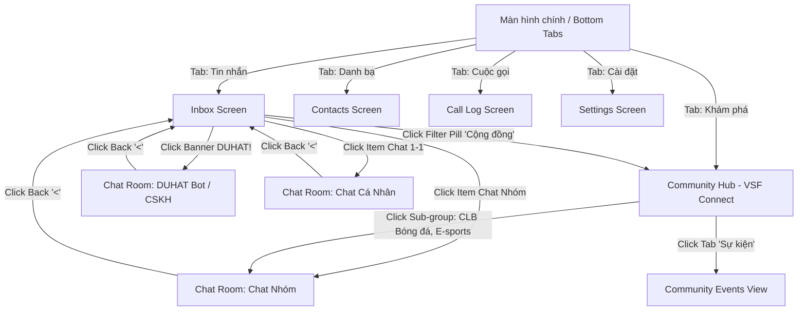
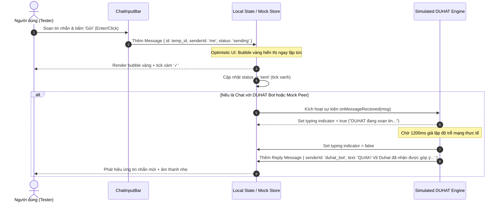

# 🦆 Duhat Chat - System Architecture & Engineering Blueprint

> **Phiên bản:** 1.0.0  
> **Mục tiêu:** Bản đặc tả kỹ thuật và kiến trúc hệ thống xuyên suốt (End-to-End System Design) dành cho AI Agent & Developer để xây dựng bản prototype tương tác cao cấp cho ứng dụng chat **Duhat**.

---

## 1. Brand Identity & Design System Tokens

### 1.1 Brand Identity
* **App Wordmark:** `Duhat` (Modern Sans-serif, nét tròn mềm mại, độ đậm Bold/Extrabold).
* **Mascot (Linh vật):** Chú vịt vàng 3D cầm điện thoại đen, tagline *"DUHAT! QUAK!?"*.
* **Visual Tone & Mood:** Tươi sáng, thân thiện, trẻ trung, hiện đại và tràn đầy năng lượng.

### 1.2 Color Palette & CSS Variables

| Token Key | Hex Value | Vai trò & Ứng dụng |
| :--- | :--- | :--- |
| `--color-primary` | `#FDC830` | Vàng thương hiệu: Banner chính, Active Tab bottom bar, Badge tag |
| `--color-primary-hover` | `#F5B800` | Trạng thái hover/active của các nút chính |
| `--color-primary-light` | `#FEF5D1` | Vàng nhạt: Nền pill filter active, Bong bóng tin nhắn người gửi |
| `--color-primary-subtle` | `#FFFDF5` | Vàng siêu nhạt: Nền highlight nhẹ, card highlight |
| `--color-bg-app` | `#FFFFFF` | Nền trắng tinh toàn màn hình, header, bottom bar |
| `--color-bg-chat` | `#F4F6F4` | Nền màn hình chat (kèm họa tiết doodle mờ vịt/mây/chat) |
| `--color-bg-input` | `#F2F3F5` | Nền ô search, ô nhập tin nhắn, các nút tròn phụ |
| `--color-text-main` | `#1A1A1A` | Chữ chính: Tiêu đề, tên liên hệ, nội dung tin nhắn |
| `--color-text-muted` | `#757575` | Chữ phụ: Timestamp, snippet preview, label tab inactive |
| `--color-border-subtle` | `#E5E7EB` | Viền xám mỏng cho card, divider, pill inactive |
| `--color-online` | `#22C55E` | Chấm báo online (Green active presence) |
| `--color-read-tick` | `#0284C7` | Tick đôi đã đọc (`✓✓`) |

### 1.3 Radii & Elevation (Bo góc & Đổ bóng)
* **Pill / Search / Actions:** `border-radius: 9999px` (`rounded-full`)
* **Banner / Cards / Media:** `border-radius: 16px` (`rounded-2xl`)
* **Avatar Cá nhân:** `rounded-full` | **Avatar Nhóm/Cộng đồng:** `rounded-2xl`
* **Chat Bubbles:** `rounded-2xl`, góc đáy phía người gửi/nhận bo nhẹ `rounded-sm` để tạo đuôi thoại.
* **Shadows:**
  * Floating Bottom Bar: `0 10px 25px -5px rgba(0, 0, 0, 0.08), 0 8px 10px -6px rgba(0, 0, 0, 0.05)`
  * Card / Modal: `0 4px 14px 0 rgba(0, 0, 0, 0.06)`

---

## 2. Navigation Architecture & User Flows



### 2.1 Chi tiết các màn hình
1. **Màn hình Inbox (`InboxView`):**
   * Top Header: Logo `Duhat` + 2 Icon chức năng (Quét QR `[—]`, Tạo mới/Thêm bạn `+`).
   * Thanh tìm kiếm `SearchBar`: Oval bo tròn, icon kính lúp.
   * Interactive Banner: Khối vàng `rounded-2xl`, linh vật vịt 3D bên phải, nút CTA đen *"Nhắn ngay DUHAT! ✨"*.
   * Filter Bar: Pill tabs `Tất cả` | `Chưa đọc` | `Nhóm` | `Cộng đồng`.
   * Danh sách hội thoại `ConversationList`: Avatar tròn/vuông bo, tên in đậm, badge unread, pin icon 📌, timestamp.
2. **Màn hình Chat Room (`ChatRoomView`):**
   * Top Header: Back button `<`, Avatar + Tên + Trạng thái (*Đang trực tuyến* / *X thành viên*), Call 📞, Video call 🎥.
   * Khung tin nhắn `MessageStream`: Wallpaper doodle mờ, bubble người gửi (vàng nhạt `#FEF5D1`), bubble người nhận (trắng), Quote box, Location Card Bubble, System Pill (`Hôm nay 11:18`).
   * Input Bar `ChatInputBar`: Nút `+` mở action drawer, ô input text, Sticker/Emoji 🙂, Gửi ảnh 🖼️.
3. **Màn hình Hub Cộng đồng (`CommunityHubView`):**
   * Header: Tên cộng đồng *"VSF Connect"* + Tag trạng thái: `Riêng tư · 2,6k thành viên`.
   * Sub-tabs: `Cộng đồng` (active gạch chân đen) | `Sự kiện`.
   * Section 1: Thông báo (`Announcements`) - Icon loa phát thanh xanh biển.
   * Section 2: Nhóm có thể tham gia (kèm nút `Tham gia`).
   * Section 3: Nhóm đã tham gia (CLB Bóng đá, E-sports, Hội ăn là có, Hội ghép là đi).
4. **Khung giả lập Mobile Frame (`MobileDeviceShell`):**
   * Bao bọc toàn bộ prototype trong một khung smartphone hiện đại (iPhone/Pixel style) với Dynamic Island / Tai thỏ, status bar (Giờ, Wifi, Pin) và Home indicator.

---

## 3. Data Entities & TypeScript Schema

```typescript
// 1. Trạng thái người dùng
export type UserPresence = 'online' | 'offline' | 'away';

export interface User {
  id: string;
  name: string;
  avatar: string;
  presence: UserPresence;
  lastSeen?: string;
  isBot?: boolean;
}

// 2. Phân loại đoạn chat
export type ConversationType = 'direct' | 'group' | 'community' | 'bot';

export interface Conversation {
  id: string;
  type: ConversationType;
  name: string;
  avatar: string;
  isOnline?: boolean;
  isPinned?: boolean;
  unreadCount: number;
  lastMessage: {
    senderId: string;
    senderName: string;
    text: string;
    timestamp: string;
    status: 'sending' | 'sent' | 'delivered' | 'read';
  };
  participantsCount?: number;
}

// 3. Thực thể Tin nhắn
export type MessageType = 'text' | 'image' | 'location' | 'quote' | 'system';
export type MessageDeliveryStatus = 'sending' | 'sent' | 'delivered' | 'read';

export interface LocationPayload {
  title: string;
  address: string;
  mapThumbnailUrl: string;
  coords: { lat: number; lng: number };
}

export interface QuotePayload {
  messageId: string;
  senderName: string;
  text: string;
}

export interface Message {
  id: string;
  conversationId: string;
  senderId: string; // 'me' đại diện cho người dùng đang trải nghiệm
  senderName: string;
  senderAvatar?: string;
  type: MessageType;
  content: string;
  quote?: QuotePayload;
  location?: LocationPayload;
  timestamp: string;
  status: MessageDeliveryStatus;
}

// 4. Nhóm Cộng đồng (Community Sub-channels)
export interface SubGroup {
  id: string;
  name: string;
  avatar: string;
  memberCount: number;
  description: string;
  isJoined: boolean;
  category: 'sports' | 'gaming' | 'food' | 'social';
}
```

---

## 4. Interactive State Machine & Real-Time Simulation



### 4.1 Quy tắc State Management (Single Source of Truth)
* **Active Filter State:** Quản lý tab lọc đang active (`all` | `unread` | `group` | `community`). Danh sách `conversations` phản ứng tức thì theo filter.
* **Active Conversation State:** Quản lý ID hội thoại đang mở. Khi chọn, tự động nạp danh sách `messages` tương ứng và xóa `unreadCount = 0`.
* **Action Drawer State (Nút `+`):** Bật menu đính kèm giả lập:
  * *Gửi vị trí demo:* Chèn ngay 1 Location Card Bubble có bản đồ vệ tinh.
  * *Gửi ảnh demo:* Chèn ảnh chú vịt Duhat hoặc ảnh mẫu.
  * *Gửi phản hồi nhanh (Quick Suggestion Chips).*

---

## 5. File Structure Blueprint (Dành cho Agent triển khai)

```
duhat-prototype/
├── index.html                   # Entry point với font Google Sans / Inter
├── package.json                 # React 18 / Lucide Icons / Tailwind hoặc CSS Module
├── src/
│   ├── assets/                  # SVG Doodles, Icon, Duhat Mascot SVGs
│   ├── components/
│   │   ├── common/
│   │   │   ├── MobileDeviceShell.tsx  # Khung điện thoại mô phỏng (Status bar, Notch)
│   │   │   ├── SearchBar.tsx          # Thanh tìm kiếm bo tròn
│   │   │   ├── FilterPills.tsx        # Thanh lọc hình con nhộng
│   │   │   └── BottomNavBar.tsx       # Floating nav bar 5 tabs
│   │   ├── inbox/
│   │   │   ├── DuhatBanner.tsx        # Banner vịt vàng 3D tương tác
│   │   │   ├── ConversationItem.tsx   # Item đoạn chat (avatar, pin, unread badge)
│   │   │   └── ConversationList.tsx   # Danh sách cuộn mượt mà
│   │   ├── chat/
│   │   │   ├── ChatHeader.tsx         # Header phòng chat (back, call icons)
│   │   │   ├── MessageBubble.tsx      # Bubble vàng (self), trắng (others), location card
│   │   │   ├── MessageStream.tsx      # Khung cuộn tin nhắn kèm wallpaper doodle
│   │   │   ├── QuickActionDrawer.tsx  # Drawer nút `+` (vị trí, ảnh, file)
│   │   │   └── ChatInputBar.tsx       # Thanh gõ tin nhắn, emoji
│   │   └── community/
│   │       ├── CommunityHeader.tsx    # Header VSF Connect
│   │       ├── SubGroupCard.tsx       # Thẻ nhóm CLB (Tham gia / Đã vào)
│   │       └── CommunityHubView.tsx   # Hub tổng hợp thông báo & nhóm
│   ├── data/
│   │   └── mockData.ts          # Dữ liệu mẫu khởi tạo phong phú
│   ├── state/
│   │   └── useChatStore.ts      # State store (quản lý tin nhắn, auto-reply, filters)
│   ├── styles/
│   │   ├── index.css            # Design tokens, reset, typography
│   │   └── doodle-pattern.css   # Họa tiết doodle mờ cho nền chat
│   ├── App.tsx                  # Điều phối chuyển màn hình & Shell
│   └── main.tsx                 # Bootstrapping
```

---

## 6. Hướng dẫn Agent Thực thi (Agent Execution Guidelines)

1. **Tuân thủ Design Tokens:** Không dùng màu tùy tiện. Mọi màu vàng, xám, xanh lá, bo góc phải khớp chính xác bảng mã ở Mục 1.2 & 1.3.
2. **Trải nghiệm tương tác chân thực (Living Prototype):**
   * Phải gõ được tin nhắn, bấm gửi hiển thị ngay.
   * Tự động phản hồi tin nhắn mẫu (Echo/Bot AI) để tester thấy được trạng thái typing và bong bóng tin nhắn nhận về.
   * Có thể chuyển đổi qua lại giữa Màn hình Chat $\leftrightarrow$ Màn hình Inbox $\leftrightarrow$ Community Hub mượt mà.
3. **Không dùng placeholder vỡ:** Sử dụng SVG vector sạch cho linh vật Duhat, avatar chất lượng cao và vector icons (Lucide Icons).
