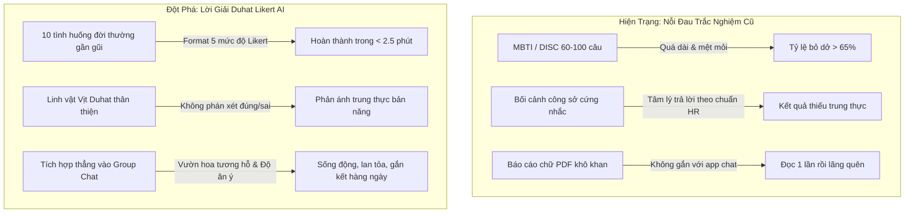
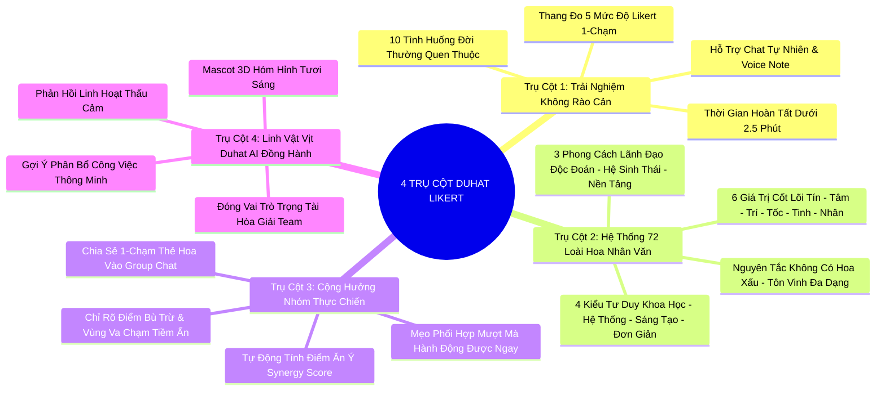
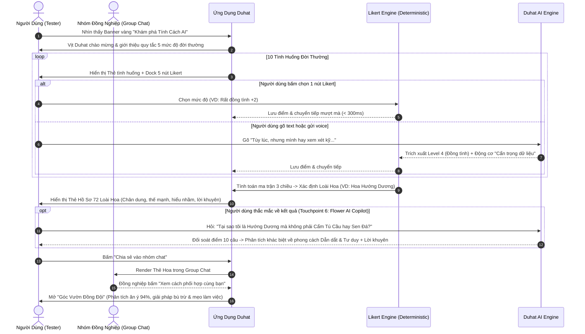

# 🦆 DUHAT - BẢN ĐẶC TẢ TẦM NHÌN SẢN PHẨM (PRODUCT VISION)
## Tính năng: Khám Phá Tính Cách AI Qua Lăng Kính Đời Thường (Format 5 Mức Độ Likert)
**Tài liệu chuẩn bị bởi:** Product Marketing Team (PMM)  
**Đối tượng nhận bàn giao & thẩm định:** Product Owner, Lead Product Manager, AI Engineering Team, UI/UX Design Team  
**Phiên bản:** 1.0 - Bản Hoàn Thiện (Ready for Review)  
**Trạng thái:** Sẵn sàng thẩm định & triển khai  
🌐 **Bản mẫu tương tác Online (Live Demo):**
* **Link Trực Tiếp (Không bị chặn tường lửa):** [https://duhat-personality.surge.sh/](https://duhat-personality.surge.sh/)
* **Bản Báo Cáo Trình Diễn C-Suite (Executive Deck):** [https://duhat-personality.surge.sh/AI_KNOWLEDGE_BASE_PRESENTATION.html](https://duhat-personality.surge.sh/AI_KNOWLEDGE_BASE_PRESENTATION.html)
* **Link Dự Phòng (GitHub Pages):** [https://daothang38.github.io/duhat-personality-test/](https://daothang38.github.io/duhat-personality-test/)

---

## 1. Tuyên Ngôn Tầm Nhìn & Bối Cảnh Chiến Lược (Strategic Context)

### 1.1 Tuyên Ngôn Tầm Nhìn (Product Vision Statement)
> *"Biến Duhat trở thành nền tảng giao tiếp đầu tiên tại Việt Nam nơi mỗi cá nhân được thấu hiểu sâu sắc và mỗi đội ngũ tìm thấy sự hòa hợp tự nhiên thông qua lăng kính đời thường không phán xét, trao quyền bởi AI đàm thoại và hệ sinh thái 72 loài hoa độc bản."*

### 1.2 Tagline Truyền Thông (Marketing Taglines)
* **Thông điệp chính:** *"Hiểu mình, thấu đồng đội – 3 phút nhẹ tênh qua lăng kính đời thường."*
* **Thông điệp lan tỏa (Viral Hook):** *"Bạn là đóa hoa nào trong khu vườn Duhat hôm nay? 🌻🪴🌸🌺"*

### 1.3 Vấn Đề Thị Trường & Cơ Hội Đột Phá (Problem & Opportunity)

* **Nỗi đau lớn nhất của các công cụ cũ:**
  1. **Gánh nặng nhận thức (Cognitive Overload):** Các bài test MBTI, Enneagram hay DISC thường đòi hỏi 60 – 120 câu hỏi trừu tượng mang đậm tính đánh giá công sở (*"Bạn có lập kế hoạch 5 năm không?", "Bạn xử lý xung đột dự án ra sao?"*), khiến người dùng rơi vào trạng thái "thi cử" và trả lời theo mẫu số chung kỳ vọng của công ty.
  2. **Tách rời hành vi giao tiếp:** Kết quả sau khi làm test chỉ là một file PDF hoặc một trang web ngoài, người dùng đọc lướt một lần rồi cất đi. Đồng nghiệp trong nhóm không hề biết cách áp dụng kết quả đó vào việc giao tiếp, phân chia công việc hay hóa giải mâu thuẫn hàng ngày.
* **Cơ hội vàng cho Duhat:**
  1. **Tự nhiên hóa (Casualization):** Đưa toàn bộ việc khám phá tính cách về **10 tình huống đời thường** (dọn dẹp góc vườn, nấu ăn cho bạn bè, đi siêu thị, xử lý khi quán ăn phục vụ chậm...).
  2. **Tối giản thao tác (Frictionless Interaction):** Cơ chế **5 mức độ Likert trực quan (🟢🟢 -> 🔴🔴)** cho phép người dùng bấm chọn phản xạ trong 1 giây, hoặc thoải mái gõ text/voice chia sẻ lý do theo ngôn ngữ tự nhiên.
  3. **Kích hoạt mạng lưới tức thì (Network Effects & Team Synergy):** Kết quả test sinh ra Thẻ Hồ Sơ Loài Hoa có thể chia sẻ 1 chạm vào Group Chat, lập tức mở khóa **Ma trận Ăn ý (Synergy Matrix)** và **Góc Vườn Đồng Đội (Team Garden)**, biến một bài test cá nhân thành tính năng gắn kết tập thể mạnh mẽ.

---

## 2. Đối Tượng Mục Tiêu & Phân Tích Chân Dung (Target Personas & JTBD)

| Nhóm Đối Tượng | Chân Dung & Bối Cảnh | Mục Tiêu & Kỳ Vọng (Jobs-To-Be-Done) | Điểm Chạm Duhat Giải Quyết |
| :--- | :--- | :--- | :--- |
| **End User (Nhân viên, Gen Z & Millennials)** | Độ tuổi 22 – 35, thích sự vui vẻ, hình ảnh đẹp, sợ bị đóng khung vào các bài đánh giá năng lực của HR. | Muốn biết phong cách làm việc tự nhiên của mình, muốn đồng nghiệp hiểu lý do mình hành xử mà không cần thanh minh, muốn khoe hình mẫu hoa độc đáo lên nhóm chat. | • Trắc nghiệm 2.5 phút bằng hình tượng hoa nhân văn. • Chia sẻ thẻ bài xinh xắn vào nhóm chat. • Tra cứu mẹo phối hợp với từng người bạn trong team. |
| **Team Leader / Project Manager** | Quản lý đội ngũ từ 5 – 20 người, đau đầu vì tình trạng "lệch sóng", mâu thuẫn ngầm trong giao tiếp và phân chia việc không đúng sở trường. | Cần hiểu nhanh phong cách phối hợp của từng thành viên để giao việc đúng người, giải quyết bất đồng quan điểm dựa trên sự thấu hiểu khách quan. | • Tính năng *Góc Vườn Đồng Đội (Team Garden)* hiển thị toàn cảnh hoa của cả team. • Phân tích điểm bù trừ & vùng va chạm giữa 2 nhân sự bất kỳ (VD: Hướng Dương + Sen Đá). |
| **People & Culture / Nội Bộ Doanh Nghiệp** | Phụ trách văn hóa nội bộ, gắn kết nhân viên, tìm kiếm các hoạt động Team Building / Ice-breaking nhẹ nhàng. | Muốn tạo môi trường làm việc tâm lý an toàn (psychological safety), gắn kết tân binh (onboarding) không gượng ép. | • Tính năng Ice-breaking hoàn hảo trong tuần đầu tiên. • Tự động kích hoạt các cuộc trò chuyện tự nhiên trong các kênh chat chung. |

---

## 3. Bốn Trụ Cột Giá Trị Cốt Lõi Của Sản Phẩm (4 Core Product Pillars)

### 3.1 Trụ cột 1: Zero Cognitive Friction (Trải Nghiệm Không Rào Cản)
* Không dùng câu hỏi giả định công sở nhức đầu. Thay bằng những tình huống đời thường sinh động (dọn vườn, phân vai nấu tiệc, đi siêu thị, xử lý khi trễ hẹn bạn bè...).
* Thang đo 5 nút Likert màu sắc trực quan (🟢🟢 Rất đồng tình $\rightarrow$ ⚪ Trung lập $\rightarrow$ 🔴🔴 Rất không đồng tình).
* Gõ chữ tự do hoặc gửi voice: Hệ thống AI nhận diện tức thì mức độ tương ứng mà không bắt ép người dùng chỉ được bấm nút.

### 3.2 Trụ cột 2: 72 Hình Mẫu Loài Hoa Nhân Văn (Zero Stigma & Positive Framing)
* Tích hợp bộ khung 3 chiều:
  $$\text{6 Giá trị} \times \text{3 Phong cách lãnh đạo} \times \text{4 Kiểu tư duy} = \mathbf{72\ \text{Hình Mẫu Loài Hoa}}$$
* **Nguyên tắc nhân văn bất di bất dịch:** Tuyệt đối không có loài hoa nào "tốt hơn" hay "kém cỏi hơn" loài hoa khác. Mỗi đóa hoa đều có vẻ đẹp riêng, thế mạnh rực rỡ và những điểm cần được đồng đội hỗ trợ che chở.

### 3.3 Trụ cột 3: Team Synergy & Living Garden (Cộng Hưởng Nhóm Thực Chiến)
* Tính năng không kết thúc khi nhận kết quả. Điểm bùng nổ nằm ở nút **"Chia sẻ vào nhóm chat"**.
* Khi chia sẻ, bot tự động kích hoạt thẻ tương tác: Đồng nghiệp trong nhóm phản hồi, hệ thống lập tức mở màn hình **Góc Vườn Đồng Đội (Team Garden)** cho thấy:
  * Sự kết hợp giữa các loài hoa (VD: *🌻 Hướng Dương + 🪴 Sen Đá: Độ ăn ý 94%*).
  * Điểm bù trừ bứt phá (Strengths synergy).
  * Vùng va chạm tiềm ẩn (Friction warning).
  * Lời khuyên phối hợp thực tế (Actionable Collaboration Tips).

### 3.4 Trụ cột 4: Linh Vật Vịt Duhat AI Đồng Hành (Emotional AI Companion)
* Linh vật Vịt Duhat 3D mang lại không khí vui tươi, giảm căng thẳng.
* Đóng vai trò là "Cố vấn giao tiếp AI" trong group chat, hỗ trợ gợi ý cách mở lời hoặc cách phân công nhiệm vụ phù hợp với tính cách từng bạn.

---

## 4. Hành Trình Trải Nghiệm Khách Hàng (End-to-End User Journey)

---

## 5. Hệ Chỉ Số Đo Lường Thành Công (Success Metrics & KPIs)

### 5.1 North Star Metric (Chỉ Số Dẫn Đường)
$$\mathbf{Team\ Synergy\ Activation\ Rate\ (TSAR)} = \frac{\text{Số nhóm có từ 3 thành viên hoàn thành test \& mở Góc Vườn}}{\text{Tổng số nhóm chat công việc active trên Duhat}}$$
* **Mục tiêu quý 1 (Q1 Target):** Đạt **45%** trên tổng số nhóm chat doanh nghiệp vừa và nhỏ (SMBs).

### 5.2 Các Chỉ Số Tương Tác & Chuyển Đổi (Funnel Metrics)

| Giai Đoạn Funnel | Chỉ Số Đo Lường | Mục Tiêu (Benchmark) | Phương Pháp Tối Ưu Hóa PMM |
| :--- | :--- | :--- | :--- |
| **Acquisition (Nhận biết)** | Click-through Rate (CTR) vào Banner Vịt Duhat trên Inbox | $\ge 28\%$ | Banner nổi bật vàng cam, linh vật vịt 3D sinh động, CTA ngắn gọn *"Nhắn ngay DUHAT! ✨"*. |
| **Activation (Hoàn thành)** | Completion Rate (Tỷ lệ làm xong đủ 10 câu) | $\ge 85\%$ | Thời gian làm dưới 2.5 phút; thanh tiến độ % trực quan; câu hỏi đời thường không áp lực. |
| **Drop-off Control** | Tỷ lệ bỏ ngang giữa các câu hỏi | $\le 2.5\%$ / câu | Chuyển câu mượt mà sau 450ms; hỗ trợ cả nút bấm lẫn gõ text. |
| **Virality (Lan tỏa)** | Group Chat Share Rate (% bấm share card vào nhóm) | $\ge 60\%$ | Card kết quả rực rỡ, badge hoa bắt mắt, nút share to rõ ràng. |
| **Retention (Gắn kết)** | Tỷ lệ quay lại tra cứu Ma trận Ăn ý sau 14 ngày | $\ge 35\%$ | Tích hợp widget Góc Vườn vào tab "Khám phá" hoặc header của từng Group Chat. |

---

## 6. Kế Hoạch Ra Mắt & Truyền Thông (Go-To-Market Plan)

### 6.1 Chiến Dịch Truyền Thông Nội Bộ: *"Vườn Hoa Đội Ngũ"*
* **Giai đoạn 1 - Teaser (7 ngày trước ra mắt):**
  * Đặt banner "Vịt Duhat đang ươm mầm điều bí mật..." kèm mini-game đoán hoa.
* **Giai đoạn 2 - Launching (Ngày ra mắt):**
  * Kích hoạt bot Duhat gửi lời mời trải nghiệm trực tiếp đến từng người dùng.
  * Tổ chức thử thách nội bộ: *"Đội ngũ nở hoa – Nhận quà trà sữa"* (Nhóm nào phủ kín vườn hoa đầu tiên nhận voucher teabreak).
* **Giai đoạn 3 - Sustained Engagement (Sau ra mắt):**
  * Mỗi khi có nhân sự mới gia nhập nhóm, Vịt Duhat tự động gửi thông báo: *"Chào đón Hoa Hướng Dương mới gia nhập vườn! Hãy xem mẹo phối hợp cùng bạn ấy nhé."*

---

## 7. Yêu Cầu Chuyển Giao Cho Đội Ngũ Product & Engineering
1. **Thẩm định Logic Điểm & 72 Loài Hoa:** Đảm bảo ma trận phân loại chính xác, công bằng, không thiên lệch.
2. **Thẩm định Điểm Chạm AI (Xem chi tiết tại tài liệu KNOWLEDGE BASE đính kèm):** Xác định rõ ràng phạm vi sử dụng AI để kiểm soát độ trễ (< 1s), chi phí API và cơ chế dự phòng 0% lỗi.
3. **Trải nghiệm trực quan:** Giữ nguyên thiết kế sống động, bo góc chuẩn mực, màu sắc nhận diện thương hiệu Duhat đã được hiện thực hóa trong bản HTML prototype.
