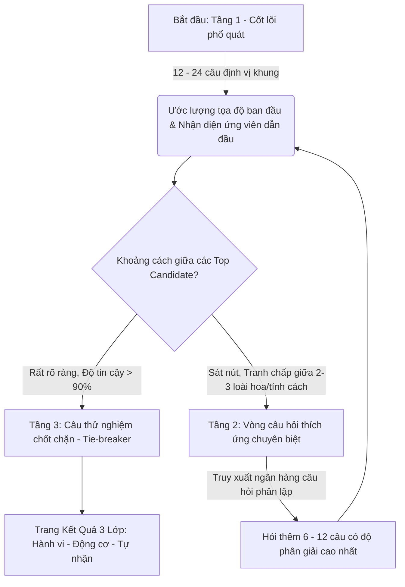

# KIẾN TRÚC ĐẶT CÂU HỎI & THUẬT TOÁN KHẢO SÁT THÍCH ỨNG
### *Phân tích chuyên sâu từ triết lý "La bàn Tư tưởng" (The Cochinchine Pensées) & Ứng dụng vào Hệ sinh thái Tính cách Duhat AI*

---

## I. GIẢI MÃ PHONG CÁCH ĐẶT CÂU HỎI CỦA "LA BÀN TƯ TƯỞNG"
*Vì sao các câu hỏi của La bàn Tư tưởng ngắn gọn nhưng buộc người dùng phải suy ngẫm sâu sắc?*

Khác với các bài test trắc nghiệm nhân sự thông thường (thường hỏi những câu hành vi bề mặt như *"Tôi thích đi tiệc"*, *"Tôi luôn nộp báo cáo đúng hạn"*), La bàn Tư tưởng đạt được chiều sâu nhờ **4 nguyên tắc thiết kế ngôn ngữ học & tâm lý học**:

### 1. Kỹ thuật "Mơ hồ có chủ ý" (Controlled Ambiguity)
- **Bản chất:** Câu hỏi không nhắc đến một công ty cụ thể, một người sếp cụ thể, hay một tình huống vụn vặt thời sự. Câu hỏi chạm thẳng vào **nguyên lý và bản chất vận hành**.
- **Tác dụng tâm lý:** Buộc người làm phải tự lấp đầy khoảng trống bằng chính hệ quy chiếu, kinh nghiệm sống và thế giới quan nội tại của họ. Hai người cùng đọc một câu ngắn 15 chữ sẽ phải tự đối chiếu với lương tâm và nguyên tắc hành động của chính mình.

### 2. Không hỏi về "Sở thích", mà hỏi về "Sự đánh đổi giá trị" (Value Trade-offs)
- Khi hỏi: *"Bạn có thích sáng tạo không?"* -> 100% người trả lời sẽ chọn Có. Đây là câu hỏi vô nghĩa.
- La bàn Tư tưởng không hỏi điều ai cũng muốn, mà hỏi: **"Bạn sẵn sàng hy sinh điều tốt đẹp nào để bảo vệ điều bạn tin là thiêng liêng hơn?"**
  - Giữa *sự hoàn hảo của trật tự* và *sự hỗn loạn đầy sức sống của đổi mới*.
  - Giữa *lòng trắc ẩn nâng đỡ kẻ yếu* và *sự sòng phẳng tuyệt đối tôn vinh năng lực*.

### 3. Cấu trúc 4 định dạng câu hỏi bổ trợ nhau
Không đơn thuần là một danh sách phẳng các câu Likert 1 chiều, hệ thống đan cài:
1. **Mệnh đề lập trường 2 chiều (Bidirectional Statements):** Đưa ra khẳng định dứt khoát về một nguyên lý. Soạn theo cả 2 chiều thuận - nghịch để triệt tiêu thiên kiến gật đầu (*Acquiescence bias*).
2. **Song đề cân nhắc (Dilemmas / Trade-off Questions):** Đặt hai giá trị *đều đáng trân trọng* lên hai đầu bàn cân (Vế A vs Vế B). Ở giữa là *"Cân nhau, khó chọn"*. Triệt tiêu thói quen chọn đáp án đúng-sai hiển nhiên.
3. **Câu hỏi đào sâu động cơ ("Vì sao?"):** Khi người dùng phản hồi xác quyết một mệnh đề, hệ thống kích hoạt câu hỏi: *"Lý do lớn nhất khiến bạn chọn vậy?"*, đưa ra các căn cơ lý lẽ khác nhau (Chủ nghĩa hiệu dụng, Đạo đức nghĩa vụ, hay Lòng trắc ẩn tự nhiên). Hai người cùng đưa ra một quyết định có thể vì hai động cơ hoàn toàn trái ngược.
4. **Câu thử nghiệm phân lập (Disambiguation Tie-breaker):** Câu hỏi dành riêng ở cuối lượt để phân tách 2 hướng đang cạnh tranh sát nút.

---

## II. CẤU TRÚC ĐẰNG SAU: CƠ CHẾ THÍCH ỨNG ĐỘNG (ADAPTIVE ENGINE)
*Làm sao để mở rộng bài test từ 10 câu lên 24, 36, 48 hay nhiều hơn tùy theo phản hồi người dùng?*

Một bài test chất lượng cao không ép tất cả mọi người làm đúng một số lượng câu cố định cứng nhắc. Nó vận hành theo mô hình **Computerized Adaptive Testing (CAT)** kết hợp **Maximum Information Gain**.



### 1. Phân bổ ngân hàng câu hỏi theo 3 tầng (3-Tier Engine)

| Tầng | Tên gọi | Số lượng câu | Mục tiêu & Cơ chế |
| :--- | :--- | :---: | :--- |
| **Tầng 1** | **Core Spectrum (Cốt lõi cố định)** | **12 – 24 câu** | Mọi người dùng đều trả lời bộ câu này. Quét qua toàn bộ các trục giá trị lớn (Tập trung vs Phân quyền, Thận trọng vs Bứt phá, Lý tính vs Cảm xúc, Cá nhân vs Tập thể). Thiết lập "Hệ tọa độ sơ bộ". |
| **Tầng 2** | **Adaptive Disambiguation (Thích ứng phân rẽ)** | **12 – 24 câu bổ sung** *(tùy biến)* | Hệ thống tính khoảng cách giữa các nhóm tính cách dẫn đầu. Nếu người dùng đang nằm ở ranh giới giữa *Hoa Sen (Trầm mặc, nguyên tắc)* và *Hoa Lan (Cầu toàn, tinh tế)*, hệ thống **chỉ rút từ ngân hàng những câu mà 2 loài hoa này bất đồng gay gắt nhất** để hỏi. Bỏ qua hoàn toàn những câu về hướng ngoại không còn giá trị phân loại. |
| **Tầng 3** | **Tie-Breaker & Hypothesis Testing (Thử nghiệm chốt chặn)** | **1 – 2 câu** | Câu hỏi có tính quyết định sinh tử. Trả lời xuôi theo giả thuyết thì xác nhận kết quả; trả lời ngược lại thì lật ngược sang hướng láng giềng. |

### 2. Điều kiện dừng thông minh (Stopping Criteria)
Thay vì ép người dùng làm hết 48 câu:
- **Dừng sớm (Early Stop ở ~24 câu):** Khi một loài hoa/tính cách đã vượt trội hẳn (Confidence Score $\ge 88\%$) và không có đối thủ cạnh tranh trong bán kính lân cận.
- **Mở rộng tối đa (Deep Probe lên 36 - 48 câu):** Khi người dùng thể hiện tính cách đa tầng/phân hóa (ví dụ: tư duy chiến lược cực kỳ lý tính nhưng khi xử lý con người lại cực kỳ cảm xúc). Khi đó, các câu hỏi phân nhánh sẽ tiếp tục được nạp để bóc tách tính cách lai (*Hybrid Archetype*).

### 3. Thuật toán so khớp: Pattern Matching thay vì Cộng điểm trung bình
- **Hạn chế của bài test cổ điển:** Cộng dồn điểm trên từng trục (Trục X = 7/10, Trục Y = 5/10). Phương pháp này làm mất hoàn toàn hình thái tương tác nội tại.
- **Thuật toán La bàn / Duhat Advanced:** Mỗi loài hoa (trong 72 biến thể) có một **Hồ sơ câu trả lời chuẩn (Ideal Response Profile)**. Hệ thống so khớp toàn bộ vector câu trả lời của người dùng với thư viện hồ sơ qua độ đo khoảng cách (Cosine Similarity / Log-likelihood có trọng số), từ đó nhận diện được cả những người trả lời dè dặt (hay chọn mức giữa) nhưng mang bản chất của một trường phái tư tưởng sâu sắc.

---

## III. MÔ HÌNH "BA LỚP THẤU TRIỆT" (THE THREE-LAYER ALIGNMENT)
Một câu trả lời trắc nghiệm không chỉ để "gán nhãn" (Labeling). Giá trị lớn nhất của trắc nghiệm tư tưởng là chỉ ra **sự mâu thuẫn nội tâm (Cognitive Dissonance)**:

```
[ LỚP 1: HÀNH VI / QUYẾT SÁCH ]  <-- Câu trả lời trên thang Likert
              ↕
[ LỚP 2: LÝ LẼ / CĂN CƠ GIÁ TRỊ ] <-- Câu hỏi "Vì sao" (Grounding)
              ↕
[ LỚP 3: TỰ NHẬN THỨC ]         <-- Nhãn mà người dùng tự nghĩ về mình
```

- **Khi 3 lớp đồng nhất:** Người dùng có độ tự nhận thức (Self-awareness) rất cao. Bản sắc kiên định.
- **Khi 3 lớp lệch pha:** 
  - *Ví dụ:* Một người luôn chọn các quyết sách khắt khe, kỷ luật sắt đá (Lớp 1), nhưng khi hỏi lý do sâu xa lại chọn *"Vì tôi thương và muốn bảo vệ sự an toàn cho mọi người"* (Lớp 2). Hệ thống sẽ chỉ ra: *"Bạn là một 'Hoa Xương Rồng mang trái tim Sen' — sự gai góc bên ngoài thực chất là lớp vỏ bảo vệ lòng trắc ẩn dễ bị tổn thương"*.
  - Đây chính là khoảnh khắc tạo ra sự thấu cảm và xúc động sâu sắc cho người dùng.

---

## IV. BỘ KHUNG CÂU HỎI MẪU CHO DUHAT AI
*(Theo chuẩn ngôn ngữ: Ngắn gọn - Đậm tính nguyên lý - Buộc phải cân não)*

### Nhóm 1: Mệnh đề Nguyên lý (Statements - Thang 5 hoặc 7 bậc)
1. *"Một kế hoạch hoàn hảo được thực thi muộn màng luôn tệ hơn một giải pháp chắp vá được hành động ngay tức khắc."*
2. *"Sự hòa thuận trong một tập thể chỉ có giá trị khi nó không được xây dựng trên sự im lặng của những người bất đồng."*
3. *"Giá trị của một cá nhân nằm ở việc họ hoàn thành xuất sắc vị trí của mình, không phải ở việc họ làm xáo trộn cấu trúc chung để khẳng định cái tôi."*
4. *"Không có sự công bằng nào lớn hơn việc đối đãi khác nhau với những người có năng lực cống hiến khác nhau."*
5. *"Quy tắc sinh ra là để bảo vệ những người bình thường khỏi sai lầm, chứ không phải để trói buộc những người nhìn thấy tương lai."*
6. *"Sự trung thực tàn nhẫn luôn nhân từ hơn một lời nói dối mang thiện ý."*

### Nhóm 2: Song đề Cân nhắc (Dilemmas - Vế A vs Vế B)
*Người dùng trượt thanh đo giữa 2 vế. Điểm giữa là "Cân nhau, khó chọn".*

* **Câu Song đề 01: Về Quyền lực & Trật tự**
  - **Vế A:** *"Một người lãnh đạo độc đoán nhưng tài ba và luôn đưa tập thể tới thắng lợi."*
  - **Vế B:** *"Một tập thể dân chủ, đồng thuận nhưng chấp nhận tiến chậm và có thể bỏ lỡ thời cơ."*

* **Câu Song đề 02: Về Tương tác Con người**
  - **Vế A:** *"Giữ gìn lòng tự trọng và sự bình an tâm lý cho đồng đội, dù phải giảm bớt tiêu chuẩn công việc."*
  - **Vế B:** *"Bảo vệ chất lượng sản phẩm cuối cùng đến cùng, dù áp lực đó có thể làm tổn thương mối quan hệ."*

* **Câu Song đề 03: Về Bản sắc Cá nhân**
  - **Vế A:** *"Là một mắt xích không thể thiếu trong cỗ máy vĩ đại, ẩn mình và đóng góp vào đại cuộc."*
  - **Vế B:** *"Là một ngọn lửa độc lập, tạo ra dấu ấn cá nhân rõ nét dù phải đứng ngoài sự bảo bọc của tập thể."*

### Nhóm 3: Câu hỏi Đào sâu Căn cơ ("Vì sao?")
*Sau khi người dùng chọn phản đối mạnh mẽ câu: "Một kế hoạch chắp vá luôn tệ hơn kế hoạch hoàn hảo":*
* **"Đâu là lý lẽ gần nhất với cách bạn nhìn nhận vấn đề?"**
  - `[A]` **Chủ nghĩa Trật tự:** Những thứ bắt đầu bằng sự cẩu thả sẽ kết thúc bằng sự sụp đổ dây chuyền không thể cứu vãn.
  - `[B]` **Lòng Tự trọng Nghề nghiệp:** Đưa ra một sản phẩm chưa chỉn chu là sự xúc phạm đối với người tiếp nhận và chính uy tín của mình.
  - `[C]` **Đạo đức Trách nhiệm:** Tốc độ chỉ phục vụ cho sự sốt ruột của số đông, còn chất lượng mới là thứ bảo vệ tập thể trước sóng gió lâu dài.
  - `[D]` **Khác:** Tôi có lý lẽ riêng không nằm trong những điều trên.

---

## V. LỘ TRÌNH TRIỂN KHAI VÀO PROTOTYPE

1. **Giai đoạn 1 (Ngân hàng câu hỏi):**
   - Xây dựng 48 mệnh đề nguyên lý chia đều cho 4 trục (Chiến lược, Vận hành, Con người, Đổi mới).
   - Xây dựng 12 câu song đề (Dilemmas) làm câu nối giữa các khối.
   - Biên soạn 24 nhánh câu hỏi "Vì sao" để đo lớp giá trị cốt lõi.

2. **Giai đoạn 2 (Thuật toán Thích ứng trên Frontend):**
   - Cài đặt module `AdaptiveQuestionEngine.js`:
     - Nhận vào câu trả lời $Q_1 \dots Q_{12}$.
     - Tính toán ma trận khoảng cách $D(U, P_i)$ với 72 loài hoa.
     - Xác định $Top\_2$ loài hoa có điểm số sát nhau nhất.
     - Lọc câu hỏi tiếp theo có phương sai (Variance) phân biệt lớn nhất giữa $Top\_2$.
     - Kích hoạt dừng khi chênh lệch xác suất $> 2.5 \times$.

3. **Giai đoạn 3 (Giao diện hiển thị kết quả 3 lớp):**
   - Bản đồ radar đa chiều.
   - Thẻ phân tích: *"Bạn được định vị là [Loài hoa A], nhưng ở trục X bạn rẽ nhánh sang [Loài hoa B]"*.
   - Giải mã Động cơ sâu xa & Điểm mù cá nhân.
